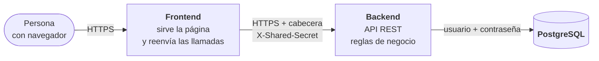
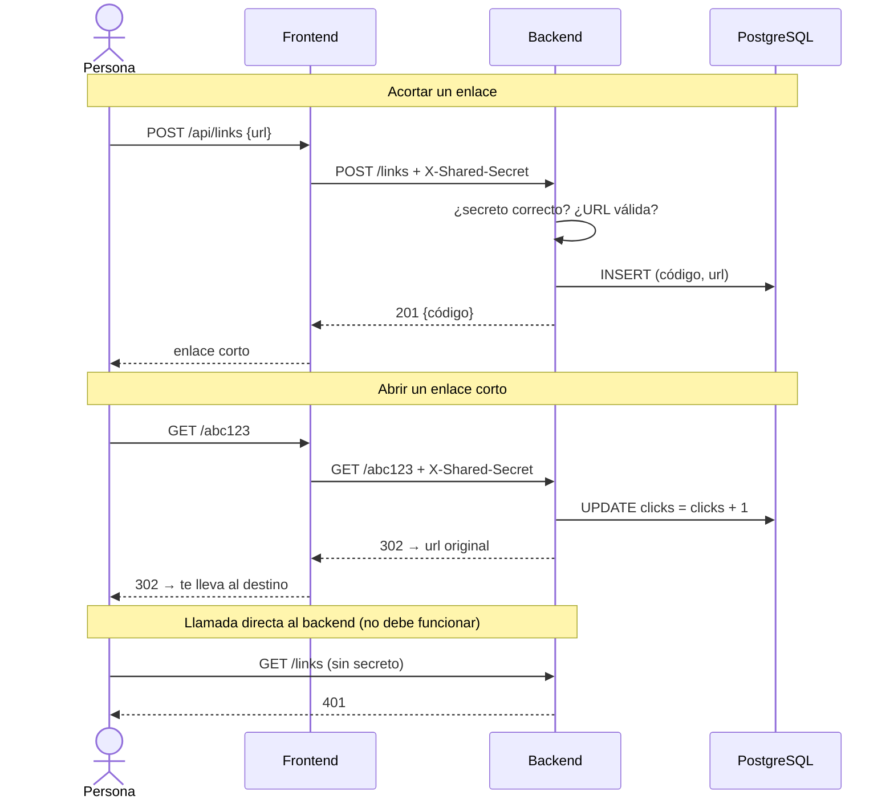

# Acortador de enlaces

Un acortador de URLs como los que usas todos los días: pegas una dirección larga, obtienes una corta, y la
plataforma cuenta cuántas veces se abre.

Es un **proyecto académico que simula un proyecto real de trabajo**. Recibes el código de una aplicación
que ya funciona, y tu trabajo es lo que un equipo de ingeniería haría antes de ponerla en producción:
**decidir dónde y cómo se despliega en Google Cloud, hacerlo con Terraform, manejar bien sus secretos y
automatizar los cambios con un pipeline.** El resultado debe ser una aplicación funcional, accesible desde
internet.

---

## 1. Qué recibes

```text
.
├── app/
│   ├── backend/         # API REST + acceso a PostgreSQL
│   ├── frontend/        # página web + reenvío de las llamadas al backend
│   └── requirements-dev.txt
├── terraform/           # aquí va TODO tu Terraform
├── ENTREGA.yaml         # los datos de tu despliegue, para el autocalificador
└── README.md
```

Haz un **fork** de este repositorio. Tu fork es tu entrega.

---

## 2. Cómo funciona la aplicación

Dos servicios y una base de datos. La gente solo habla con el frontend; el backend no debería recibir
llamadas que no vengan de él.



> Este diagrama es **lógico**: dice qué se comunica con qué, no dónde corre cada pieza. Esa decisión
> es tuya.

### Qué pasa cuando alguien usa la app



### API del backend

Todas las rutas, salvo `/health`, exigen la cabecera `X-Shared-Secret`.

| Método | Ruta | Descripción |
|---|---|---|
| `GET` | `/health` | Estado del servicio (sin autenticación) |
| `POST` | `/links` | Crea un enlace. Cuerpo: `{"url": "https://..."}` |
| `GET` | `/links` | Últimos 50 enlaces con sus clics |
| `GET` | `/links/{code}/stats` | Estadísticas de un enlace |
| `GET` | `/{code}` | Redirige (302) al destino y suma un clic |

---

## 3. Lo que necesita cada servicio para funcionar

Este es el contrato. **Cómo y dónde lo proporcionas es decisión tuya.**

| | Backend | Frontend |
|---|---|---|
| **Instalar** | `pip install -r requirements.txt` | `pip install -r requirements.txt` |
| **Arrancar** (desde su carpeta) | `uvicorn main:app --host 0.0.0.0 --port $PORT` | `uvicorn main:app --host 0.0.0.0 --port $PORT` |
| **Python** | 3.11 | 3.11 |
| **Variables de entorno** | `DB_HOST`, `DB_NAME`, `DB_USER`, `DB_PASSWORD`, `SHARED_SECRET` | `BACKEND_URL`, `SHARED_SECRET` |
| **Base de datos** | PostgreSQL accesible desde el backend | no la usa |
| **Salud** | `GET /health` → 200 | `GET /health` → 200 |

Notas:
- `DB_HOST` puede ser un nombre de host o la ruta de un socket Unix (por ejemplo `/cloudsql/...`).
  Si no la defines, el valor por defecto es `localhost`. Valores por defecto de `DB_NAME` y `DB_USER`:
  `shortener`.
- El backend **crea su propia tabla** al arrancar; no necesitas migraciones.
- `SHARED_SECRET` debe ser **el mismo valor** en el frontend y en el backend.
- `BACKEND_URL` es la dirección base del backend, por ejemplo `https://mi-backend.example.com`.

---

## 4. Lo que tienes que hacer

1. **Desplegar la aplicación en Google Cloud**, accesible desde internet. Tú decides qué servicios de
   Google Cloud usar para el frontend, el backend y la base de datos.
2. **Hacerlo todo con Terraform**, dentro de la carpeta `terraform/`. Ningún recurso se crea a mano en la
   consola. Guarda el *state* en un bucket de Cloud Storage.
3. **Manejar los secretos como se hace en un entorno real.** Los valores sensibles no pueden vivir en el
   código ni en el repositorio, y los secretos se gestionan con **Secret Manager**.
4. **Automatizar los cambios con un pipeline** en GitHub Actions (`.github/workflows/`). Mínimo, en cada
   cambio debe: revisar el estilo del código, buscar vulnerabilidades y construir la aplicación. Si algo
   falla, el cambio no debe poder publicarse.
5. **Completar `ENTREGA.yaml`** con el ID de tu proyecto y la URL pública del frontend.

Tu proyecto tiene que **funcionar**: se podrán crear enlaces desde el frontend, abrirlos y ver sus clics.

---

## 5. Correrlo en tu máquina

```bash
# PostgreSQL local
docker run -d --name pg -p 5432:5432 \
  -e POSTGRES_USER=shortener -e POSTGRES_PASSWORD=dev -e POSTGRES_DB=shortener postgres:15

python3 -m venv .venv && source .venv/bin/activate
pip install -r app/requirements-dev.txt

# Terminal 1: backend
cd app/backend
DB_PASSWORD=dev SHARED_SECRET=secreto-local uvicorn main:app --port 8001

# Terminal 2: frontend
cd app/frontend
SHARED_SECRET=secreto-local BACKEND_URL=http://localhost:8001 uvicorn main:app --port 8000
```

Abre <http://localhost:8000>. Los tests no necesitan base de datos:

```bash
pytest app/backend/tests && pytest app/frontend/tests
ruff check app/
```

---

## 6. Cómo se evalúa

La evaluación es **automática** y se hace sobre tu repositorio y sobre tu despliegue en funcionamiento. En
términos generales se revisa que:

- la aplicación funcione desde la URL que entregaste,
- el repositorio no contenga secretos,
- los secretos estén en Secret Manager y la aplicación los use,
- las dependencias no tengan vulnerabilidades conocidas graves,
- toda la infraestructura esté definida en Terraform,
- el pipeline exista y bloquee los cambios con problemas.

Al terminar la evaluación, la infraestructura se destruye.
