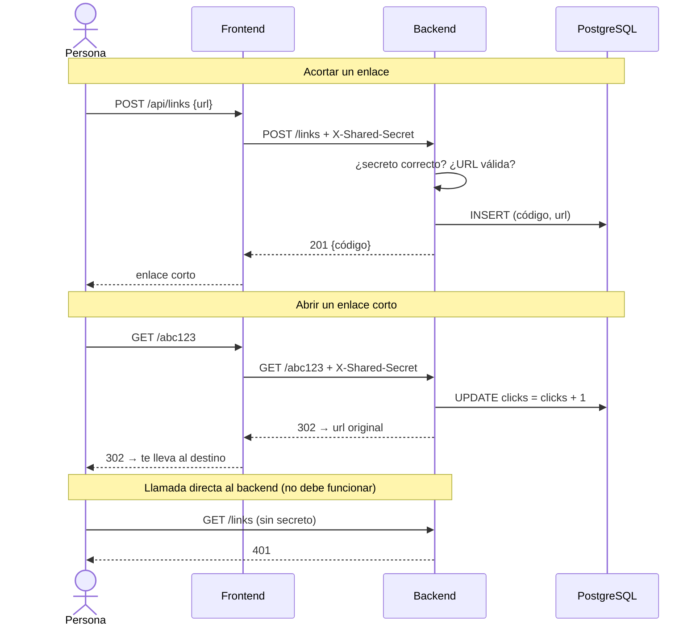

# Acortador de enlaces

Un acortador de URLs como los que usas todos los días: pegas una dirección larga, obtienes una corta, y la
plataforma cuenta cuántas veces se abre.

Es un **proyecto académico que simula un proyecto real de trabajo**. Recibes el código de una aplicación
que ya funciona, y tu trabajo es lo que un equipo de ingeniería haría antes de ponerla en producción:
**decidir dónde y cómo se despliega en Google Cloud, hacerlo con Terraform, manejar bien sus secretos y
automatizar los cambios con un pipeline.** El resultado debe ser una aplicación funcional, accesible desde
internet.

Al terminarlo habrás practicado:

- elegir los servicios de Google Cloud adecuados para cada pieza,
- describir la infraestructura como código con Terraform,
- gestionar secretos con Secret Manager en lugar de dejarlos en el código,
- automatizar controles de calidad y de seguridad con GitHub Actions.

**La aplicación ya funciona; tu trabajo es todo lo que la rodea.**

---

## 1. Qué recibes

```text
.
├── app/
│   ├── backend/         # API REST + acceso a PostgreSQL
│   ├── frontend/        # página web + reenvío de las llamadas al backend
│   └── requirements-dev.txt
├── autocalificador/     # la rúbrica automática, para que te autocorrijas antes de entregar
├── terraform/           # aquí va TODO tu Terraform
├── ENTREGA.yaml         # los datos de tu despliegue, para el autocalificador
└── README.md
```

Haz un **fork** de este repositorio. Tu fork es tu entrega.

| Recibes | No recibes (lo haces tú) |
|---|---|
| El código del **frontend** y del **backend** | La infraestructura: decides qué servicios de Google Cloud usar |
| Los tests y las dependencias | El Terraform: va en la carpeta `terraform/`, que llega vacía |
| Este `README.md` con el contrato de cada servicio | El pipeline de GitHub Actions |
| Una carpeta `terraform/` y un `ENTREGA.yaml` para completar | Los Dockerfiles, si tu plataforma los necesita |

> ⚠️ GitHub **desactiva GitHub Actions por defecto en los forks**. Entra a la pestaña *Actions* de tu fork
> y actívalo antes de crear tu pipeline, o no se ejecutará nada.

---

## 2. Cómo funciona la aplicación

Dos servicios y una base de datos. La gente solo habla con el frontend; el backend no debería recibir
llamadas que no vengan de él.


> Este diagrama es **lógico**: dice qué se comunica con qué, no dónde corre cada pieza. Esa decisión
> es tuya.

### Qué pasa cuando alguien usa la app



### API del backend

Todas las rutas, salvo `/health`, exigen la cabecera `X-Shared-Secret`.

| Método | Ruta | Descripción |
|---|---|---|
| `GET` | `/health` | Estado del servicio (sin autenticación) |
| `POST` | `/links` | Crea un enlace. Cuerpo: `{"url": "https://..."}` |
| `GET` | `/links` | Últimos 50 enlaces con sus clics |
| `GET` | `/links/{code}/stats` | Estadísticas de un enlace |
| `GET` | `/{code}` | Redirige (302) al destino y suma un clic |

---

## 3. Lo que necesita cada servicio para funcionar

Este es el contrato. **Cómo y dónde lo proporcionas es decisión tuya.**

| | Backend | Frontend |
|---|---|---|
| **Instalar** | `pip install -r requirements.txt` | `pip install -r requirements.txt` |
| **Arrancar** (desde su carpeta) | `uvicorn main:app --host 0.0.0.0 --port $PORT` | `uvicorn main:app --host 0.0.0.0 --port $PORT` |
| **Python** | 3.11 | 3.11 |
| **Variables de entorno** | `DB_HOST`, `DB_NAME`, `DB_USER`, `DB_PASSWORD`, `SHARED_SECRET` | `BACKEND_URL`, `SHARED_SECRET` |
| **Base de datos** | PostgreSQL accesible desde el backend | no la usa |
| **Salud** | `GET /health` → 200 | `GET /health` → 200 |

Notas:
- `$PORT` es una variable de entorno con el puerto en el que debe escuchar el servicio (en PowerShell se
  escribe `$env:PORT`).
- **Este repositorio no incluye Dockerfile.** Si la plataforma que elijas necesita contenedores, escribir la
  imagen es parte de tu trabajo; la tabla de arriba te dice cómo arranca cada servicio.
- `DB_HOST` puede ser un nombre de host o la ruta de un socket Unix (por ejemplo `/cloudsql/...`).
  Si no la defines, el valor por defecto es `localhost`. Valores por defecto de `DB_NAME` y `DB_USER`:
  `shortener`.
- El backend **crea su propia tabla** al arrancar; no necesitas migraciones.
- `SHARED_SECRET` debe ser **el mismo valor** en el frontend y en el backend.
- `BACKEND_URL` es la dirección base del backend, por ejemplo `https://mi-backend.example.com`.

---

## 4. Lo que tienes que hacer

**Requisitos previos:** una cuenta de Google Cloud con facturación, `gcloud`, `terraform` (≥ 1.9), `git` y
una cuenta de GitHub. Para que Terraform pueda actuar en tu nombre, ejecuta una vez
`gcloud auth application-default login`.

**Lo único que se hace a mano** (todo lo demás, incluido habilitar las APIs, es Terraform):

1. Crear el proyecto de Google Cloud y vincularle la facturación.
2. Crear el bucket donde Terraform guardará su *state*. Terraform no puede crear el bucket que él mismo
   necesita para arrancar.

**El trabajo:**

1. **Desplegar la aplicación en Google Cloud**, accesible desde internet. Tú decides qué servicios de
   Google Cloud usar para el frontend, el backend y la base de datos.
2. **Hacerlo todo con Terraform**, dentro de la carpeta `terraform/`. Si un recurso no está ahí, no cuenta.
   El *state* va en el bucket de Cloud Storage del paso manual 2.
3. **Manejar los secretos como se hace en un entorno real.** Los valores sensibles no pueden vivir en el
   código ni en el repositorio, y los secretos se gestionan con **Secret Manager**.
4. **Crear un pipeline en GitHub Actions** (`.github/workflows/`). En cada cambio debe, como mínimo:
   revisar el estilo del código, buscar vulnerabilidades y construir la aplicación. **Si encuentra un
   problema, el pipeline debe fallar.** El pipeline *no* necesita desplegar nada en Google Cloud. En tu
   entrega final, la última ejecución en la rama `main` debe estar en verde.
5. **Darle acceso al evaluador, también con Terraform.** Es obligatorio y tiene su propia sección: la 5.
6. **Completar `ENTREGA.yaml`** con el ID de tu proyecto y la URL pública del frontend. Es lo que usa el
   autocalificador para encontrar tu despliegue:

   ```yaml
   project_id: mi-proyecto-123       # el ID de tu proyecto de Google Cloud
   frontend_url: https://...         # la URL pública del frontend
   ```
7. **Declarar el uso de IA.** Puedes usar herramientas de IA, pero al final de este `README.md` agrega una
   sección «Uso de IA» que diga qué herramienta usaste y para qué partes del trabajo.

> 💡 Al habilitar APIs con Terraform, el primer `terraform apply` puede fallar con un error `403` o
> `IAM_PERMISSION_DENIED` en el recurso que sigue (por ejemplo, Artifact Registry): el API recién habilitado
> tarda unos segundos en propagarse. No es un error de tu código; espera un minuto y vuelve a ejecutar
> `terraform apply`. Si defines `depends_on` hacia el recurso que habilita el API, ocurre menos.

Tu proyecto tiene que **funcionar**: se podrán crear enlaces desde el frontend, abrirlos y ver sus clics.

### Costos y recomendaciones

Algunos servicios cobran **por hora mientras existan**; una base de datos Cloud SQL es el caso típico. Para
no llevarte sorpresas:

- Crea una alerta de presupuesto en tu proyecto desde el primer día.
- Usa el tamaño más pequeño de cada servicio: es un ejercicio, no una carga real.
- Destruye la infraestructura cuando no la estés usando. Con Terraform es `terraform destroy`, y volver a
  crearla es repetir el `apply`.
- Antes de entregar, vuelve a crearla desde cero para comprobar que tu Terraform realmente lo describe todo.

**Tropiezos frecuentes**

- Crear una base de datos tarda varios minutos: aplica la infraestructura una vez y avanza con el pipeline
  mientras espera.
- Si no tienes Docker en tu máquina, puedes construir las imágenes con Cloud Build.
- Si tu pipeline sale en rojo desde el primer día, es normal: el código que recibes trae problemas que tienes
  que encontrar y arreglar.

---

## 5. Dar acceso al evaluador (obligatorio)

Para poder calificar tu despliegue y destruirlo al terminar, el evaluador necesita entrar a **tu proyecto de
Google Cloud**. Eres tú quien se lo concede, **con Terraform** y dentro de la carpeta `terraform/`.

**La cuenta del evaluador** (cópiala, no la teclees):

```text
vdrestrepot@unal.edu.co
```

En IAM se escribe como miembro de tipo usuario: `user:vdrestrepot@unal.edu.co`.

**Los roles que debes concederle, y solo estos dos:**

| Rol | Para qué lo necesita |
|---|---|
| `roles/viewer` | Leer la configuración de tu infraestructura y tu *state*, para comprobar lo que hiciste. |
| `roles/resourcemanager.projectDeleter` | Borrar el proyecto completo cuando termine la evaluación. |

**Lo que NO debes darle:**

- Ningún otro rol, y menos `roles/owner` o `roles/editor`.
- Acceso para leer secretos en Secret Manager (`roles/secretmanager.secretAccessor`). El evaluador comprueba
  que tus secretos existen y tienen valor, pero **nunca necesita leerlos**.

> **Sobre el *state*.** `roles/viewer` permite leer el bucket donde está tu *state*, y el *state* de Terraform
> puede guardar en texto plano los valores que Terraform genera (contraseñas, por ejemplo). Por eso el bucket
> del *state* nunca debe ser público, y por eso es importante entender qué guarda cada recurso.

**Cómo comprobar que lo hiciste bien.** Este comando debe mostrar exactamente esos dos roles, ni más ni menos:

```text
gcloud projects get-iam-policy TU_PROYECTO --flatten="bindings[].members" --filter="bindings.members:vdrestrepot@unal.edu.co" --format="value(bindings.role)"
```

(Es un solo comando en una línea: funciona igual en macOS, Linux y Windows.)

**Qué va a pasar con tu proyecto.** Cuando termine la evaluación, el evaluador **borrará el proyecto
entero** con el rol `projectDeleter`. No guardes ahí nada que quieras conservar. Google mantiene un proyecto
borrado durante 30 días antes de eliminarlo definitivamente, y deja de cobrarte desde el momento del
borrado.

**Dale el acceso *antes* de entregar.** Sin estos permisos no se puede evaluar tu despliegue.

---

## 6. Correrlo en tu máquina

Necesitas Python 3.11, Docker (Docker Desktop en Windows y macOS) y tres terminales. Los comandos cambian
según tu sistema; en Windows también puedes usar WSL y seguir la versión de Linux.

**Primero, la base de datos** (igual en todos los sistemas):

```text
docker run -d --name pg -p 5432:5432 -e POSTGRES_USER=shortener -e POSTGRES_PASSWORD=dev -e POSTGRES_DB=shortener postgres:15
```

### macOS y Linux (bash o zsh)

```bash
python3 -m venv .venv && source .venv/bin/activate
pip install -r app/requirements-dev.txt

# Terminal 1 (activa el entorno virtual: source .venv/bin/activate)
cd app/backend
DB_PASSWORD=dev SHARED_SECRET=secreto-local uvicorn main:app --port 8001

# Terminal 2 (activa el entorno virtual otra vez)
cd app/frontend
SHARED_SECRET=secreto-local BACKEND_URL=http://localhost:8001 uvicorn main:app --port 8000
```

### Windows (PowerShell)

```powershell
py -3.11 -m venv .venv
.venv\Scripts\Activate.ps1
pip install -r app/requirements-dev.txt

# Terminal 1 (activa el entorno virtual: .venv\Scripts\Activate.ps1)
cd app\backend
$env:DB_PASSWORD="dev"; $env:SHARED_SECRET="secreto-local"
uvicorn main:app --port 8001

# Terminal 2 (activa el entorno virtual otra vez)
cd app\frontend
$env:SHARED_SECRET="secreto-local"; $env:BACKEND_URL="http://localhost:8001"
uvicorn main:app --port 8000
```

Si PowerShell no deja activar el entorno virtual, ejecuta una vez
`Set-ExecutionPolicy -Scope CurrentUser RemoteSigned`.

Abre <http://localhost:8000>. Los tests no necesitan base de datos (desde la raíz del repositorio, con el
entorno virtual activo; en cualquier sistema):

```text
pytest app/backend/tests
pytest app/frontend/tests
ruff check app/
```

---

## 7. Cómo se evalúa

La calificación es **automática**: un script revisa tu repositorio y tu despliegue en funcionamiento. No hay
puntos por elegir un servicio concreto de Google Cloud: cualquier plataforma sirve si la aplicación funciona y
cumple los requisitos.

| Criterio | Cómo se verifica | Puntos |
|---|---|---:|
| La aplicación funciona | Desde `frontend_url`: crea un enlace, lo abre (redirección) y comprueba que cuenta los clics | 20 |
| El repositorio no contiene secretos | Escaneo de secretos del código: los valores originales ya no aparecen | 15 |
| Dependencias sin la vulnerabilidad conocida | Escaneo de dependencias: ya no aparece la vulnerabilidad que venía en el código | 10 |
| Secretos en Secret Manager y en uso | Existen, tienen una versión habilitada y el servicio los recibe como secreto, no como texto plano | 15 |
| Todo en Terraform | `terraform/` con los recursos y *state* remoto en Cloud Storage con lo que existe en el proyecto | 15 |
| Pipeline | Existe en `.github/workflows/`, revisa estilo, vulnerabilidades y construcción, y su última ejecución en `main` está en verde | 15 |
| Acceso del evaluador y entrega | Exactamente los dos roles de la sección 5 y `ENTREGA.yaml` completo | 10 |
| **Total** | | **100** |

La forma exacta de comprobar cada criterio puede variar según los servicios que elijas, pero el criterio es el
mismo para todos.

**Autocalificador.** La carpeta `autocalificador/` es la misma rúbrica automática de la tabla. Córrela cuantas
veces quieras antes de entregar (las instrucciones están en su `README.md`); lo que marque en rojo es lo que te
resta puntos.

**Casos que no se muestran.** La evaluación oficial la hace el calificador del profesor, que no se publica y que
incluye revisiones adicionales a las de la tabla. Sacar 100 en el autocalificador es necesario, pero no
garantiza la nota final.

Al terminar la evaluación, el proyecto se borra (sección 5).
